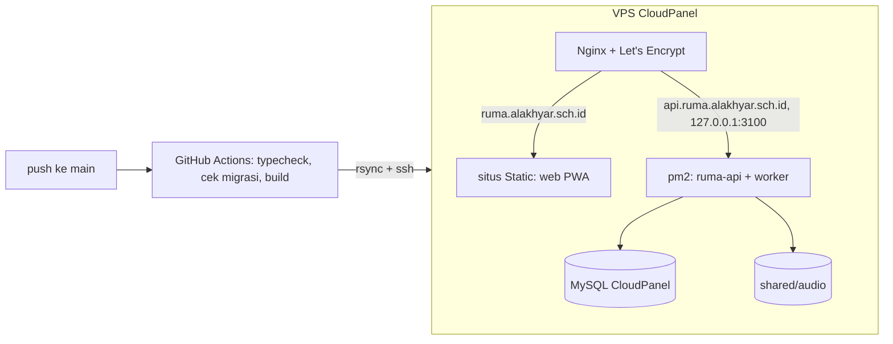

# Deploy ke VPS CloudPanel (GitHub Actions)

Setiap push ke `main` membangun aplikasi di runner GitHub lalu mengirim hasilnya ke VPS lewat SSH. **Tidak ada build di server.**



Alur API per rilis: kirim ke `~/app/releases/<waktu>-<sha>/` → **migrasi database** → pindah symlink `current` → `pm2 reload` → **health check** `/health`. Health check gagal = otomatis kembali ke rilis sebelumnya. Web dikirim setelah API sehat.

Nama domain di bawah adalah usulan (`ruma.alakhyar.sch.id` dan `api.ruma.alakhyar.sch.id`: satu situs yang sama, jadi cookie sesi `SameSite=Lax` tetap terkirim). Ganti sesuai domain Anda.

## 1. Sekali saja di VPS

**Sebagai root:**

```bash
apt update && apt install -y ffmpeg rsync     # ffmpeg+ffprobe dipakai worker transkripsi; rsync dipakai deploy
```

**DNS:** buat record A untuk kedua domain ke IP VPS.

**Di CloudPanel:**

1. **Databases → Add Database**: buat database dan user (catat password). Host `127.0.0.1`.
2. **Sites → Add Site → Create a Node.js Site** untuk API: domain `api.ruma.alakhyar.sch.id`, pilih **Node.js 22**, **App Port `3100`**, catat *Site User* (mis. `ruma-api`).
3. **Sites → Add Site → Create a Static HTML Site** untuk web: domain `ruma.alakhyar.sch.id`, catat *Site User* (mis. `ruma-web`) dan root (`/home/ruma-web/htdocs/ruma.alakhyar.sch.id`).
4. Di kedua situs: **SSL/TLS → New Let's Encrypt Certificate** (setelah DNS menunjuk ke VPS).
5. Situs web → **Vhost**: ganti blok `location / { ... }` dengan isi `deploy/nginx-spa.conf` (SPA fallback ke `index.html`, `sw.js` tidak di-cache). Simpan; CloudPanel memeriksa sintaks dan membatalkan bila salah.

**Kunci SSH deploy** (di mesin Anda):

```bash
ssh-keygen -t ed25519 -f ruma-deploy -C "github-actions-ruma" -N ""
```

Tempel isi `ruma-deploy.pub` pada user SSH **kedua** situs (CloudPanel → situs → tab **SSH/FTP**, kolom Public SSH Key). Uji dari mesin Anda (harus mencetak versi Node, bukan galat):

```bash
ssh -i ruma-deploy ruma-api@IP_VPS 'ls ~/.nvm/nvm.sh && . ~/.nvm/nvm.sh && node -v'
ssh-keyscan -p 22 IP_VPS      # keluarannya menjadi secret DEPLOY_KNOWN_HOSTS
```

**Di VPS sebagai site user API** (`ssh ruma-api@IP_VPS`):

```bash
. ~/.nvm/nvm.sh && npm install -g pm2
mkdir -p ~/app/shared/audio
nano ~/app/shared/.env         # isi dari deploy/api.env.production.example (nilai asli)
chmod 600 ~/app/shared/.env

# Hidup lagi setelah reboot (cara resmi CloudPanel): salin keluaran `echo $PATH`, lalu `crontab -e`:
#   PATH=<tempel keluaran echo $PATH>
#   @reboot pm2 resurrect &> /dev/null
```

Hal penting di `.env` produksi: `HOST=127.0.0.1`, `PORT=3100` (sama dengan App Port CloudPanel), `API_URL`/`APP_URL` persis URL publik (`https://…`), `AUDIO_DIR=/home/ruma-api/app/shared/audio`. Redirect URI Google OAuth: `https://api.ruma.alakhyar.sch.id/auth/google/callback`.

## 2. GitHub

**Settings → Environments → New environment `production`** (opsional: *Required reviewers* agar tiap deploy perlu persetujuan). Isi di environment itu:

| Jenis | Nama | Isi |
|---|---|---|
| Secret | `DEPLOY_SSH_KEY` | isi `ruma-deploy` (kunci privat) |
| Secret | `DEPLOY_KNOWN_HOSTS` | keluaran `ssh-keyscan -p 22 IP_VPS` (host key dipin; tanpa `StrictHostKeyChecking=no`) |
| Variable | `DEPLOY_HOST` | IP/hostname VPS |
| Variable | `DEPLOY_SSH_PORT` | opsional, default `22` |
| Variable | `API_SSH_USER` | site user API, mis. `ruma-api` |
| Variable | `WEB_SSH_USER` | site user web, mis. `ruma-web` |
| Variable | `WEB_ROOT` | root situs web, mis. `/home/ruma-web/htdocs/ruma.alakhyar.sch.id` |
| Variable | `VITE_API_URL` | `https://api.ruma.alakhyar.sch.id` (dibakar ke bundel web saat build) |
| Variable | `API_APP_DIR` | opsional, default `app` (relatif terhadap home) |
| Variable | `PM2_NAME` | opsional, default `ruma-api` |

## 3. Deploy pertama

Push ke `main` atau **Actions → Deploy → Run workflow**. Periksa:

```bash
curl -s https://api.ruma.alakhyar.sch.id/health     # {"ok":true,"migrasiTertinggal":0}
```

Buka `https://ruma.alakhyar.sch.id`, login dengan akun sekolah. Email di `SUPERADMIN_EMAILS` menjadi superadmin saat login pertama.

## 4. Operasional

- **CI** (`ci.yml`) berjalan di setiap pull request: typecheck, build, dan **memastikan `schema.ts` tidak berubah tanpa migrasi** (`drizzle-kit generate` tidak boleh menghasilkan berkas baru).
- **Log:** `pm2 logs ruma-api`. Status: `pm2 status`. Restart manual: `pm2 reload ~/app/current/ecosystem.config.cjs --update-env`.
- **Rollback:** *Actions → Rollback API → Run workflow* (kosong = rilis sebelum yang aktif; atau isi ID dari `ls ~/app/releases`). **Hanya kode; database tidak dikembalikan.** Karena itu migrasi harus kompatibel dengan kode lama: tambah kolom/tabel dulu, hapus atau ubah nama di rilis berikutnya.
- **Migrasi yang gagal** menghentikan deploy sebelum rilis berpindah; rilis lama tetap berjalan.
- **Rilis lama** dihapus otomatis (disimpan 5 terbaru). Rahasia dan audio ada di `~/app/shared` sehingga tidak ikut terhapus.
- **Backup:** audio mentah di `~/app/shared/audio` dan database adalah satu-satunya salinan. Aktifkan **Backups** CloudPanel (database dan home site user API) ke penyimpanan jarak jauh, dan uji pemulihan sekali.
- **Keamanan:** API hanya mendengarkan `127.0.0.1` (Nginx satu-satunya pintu masuk); jangan membuka port 3100 di firewall. Kunci deploy khusus untuk ini; cabut dari CloudPanel bila bocor.

## Belum diverifikasi

Skrip server (`deploy/remote-api.sh`, `remote-rollback.sh`) diuji di lokal dengan pm2 dan MariaDB sungguhan: deploy, pindah rilis, rollback otomatis saat health check gagal, dan rollback manual. **Workflow GitHub Actions dan konfigurasi CloudPanel belum pernah dijalankan di lingkungan sebenarnya** (YAML hanya divalidasi sintaksnya). Kemungkinan penyesuaian pada deploy pertama: label menu CloudPanel versi Anda, user SSH yang tidak memuat nvm (lihat uji `node -v` di atas), dan versi Node situs yang harus 22.
