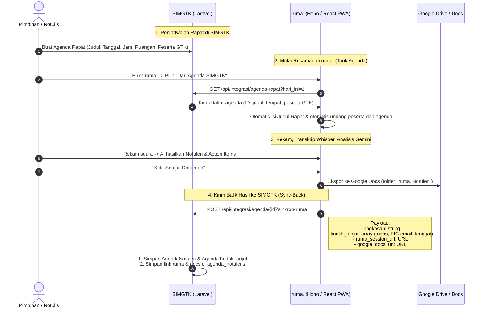

# Konsep Arsitektur & Sinkronisasi: Agenda Rapat SIMGTK ⇄ ruma.

**Berdasarkan penelusuran kode sumber asli di repositori SIMGTK (`app/Models/Agenda.php`, `AgendaNotulen.php`, dan `AgendaNotulenService.php`).**

Di SIMGTK, modul rapat dan notulen ternyata sudah memiliki struktur data yang sangat matang:
- Model `Agenda`: mencakup `judul`, `tanggal`, `jam_mulai`, `jam_selesai`, `tempat`, `mode` (luring/daring), serta relasi `pesertas` (tabel `agenda_pesertas`).
- Model `AgendaNotulen`: mencakup `ringkasan`, `disusun_oleh`, `disahkan_oleh`, `disahkan_at`.
- Model `AgendaTindakLanjut`: daftar tugas (*action items*) lengkap dengan `deskripsi`, `penanggung_jawab_user_id`, dan `tenggat`, yang bahkan terintegrasi langsung ke modul **Proyek/Tasks SIMGTK** (`task_id`).

---

## 1. Jawaban Arsitektur: Bagaimana Pola Integrasinya?

Menjawab pertanyaan Anda:
> *"Apakah ruma hanya menyimpan link agenda (nanti api yang mengambil isi agenda), ataukah di simgtk yang membuat meeting recording di ruma ketika buat agenda? Dan di agenda simgtk nanti ketika terintegrasi ada link recording ruma dan link docs nya?"*

### Pola Integrasi yang Direkomendasikan: **"Hubungan Longgar Dua Arah (Pull & Sync-Back)"**



---

## 2. Mengapa Bukan SIMGTK yang Otomatis Membuat Sesi di ruma.?

1. **Jadwal Belum Tentu Direkam:** Tidak semua agenda rapat di SIMGTK perlu direkam suara (misal briefing cepat 5 menit). Membiarkan notulis memilih agenda saat membuka ruma. jauh lebih bersih.
2. **Kemandirian Sistem (*Fault Tolerance*):** Jika server ruma. sedang restart atau kuota habis, staf administrasi di SIMGTK tetap bisa menjadwalkan agenda tanpa error 500.

---

## 3. Apa yang Perlu Ditambahkan di SIMGTK?

### A. Di Database SIMGTK (Tabel `agenda_notulens`)
Tambahkan 2 kolom link:
```sql
ALTER TABLE `agenda_notulens` 
ADD COLUMN `ruma_session_url` VARCHAR(500) NULL AFTER `ringkasan`,
ADD COLUMN `google_docs_url` VARCHAR(500) NULL AFTER `ruma_session_url`;
```

### B. Endpoint API di SIMGTK (`routes/api.php` SIMGTK)
Menggunakan otentikasi Sanctum Bearer Token yang sudah ada:
1. `GET api/integrasi/agenda-rapat`:
   - Mengembalikan daftar rapat hari ini / aktif: `[{ id, judul, tanggal, jam_mulai, tempat, pesertas: [{ user_id, nama, email }] }]`.
2. `POST api/integrasi/agenda/{agenda}/sinkron-ruma`:
   - Menerima payload dari ruma.:
     - `ringkasan`: Teks ringkasan eksekutif dari AI.
     - `tindak_lanjut`: Array tugas, nama PIC, dan tenggat waktu (SIMGTK otomatis mencocokkan ke `agenda_tindak_lanjut`).
     - `ruma_session_url`: Tautan rekaman pemutar suara & transkrip karaoke ruma.
     - `google_docs_url`: Tautan dokumen Google Docs resmi.

### C. Di Tampilan Notulen SIMGTK (`resources/js/Pages/Agenda/Notulen.vue` atau Blade)
Tepat di bagian atas notulen SIMGTK, tampilkan tombol:
- 🎧 **`[Dengarkan Rekaman & Transkrip (ruma.)]`** ➔ Membuka sesi di ruma.
- 📄 **`[Buka Dokumen Resmi (Google Docs)]`** ➔ Membuka dokumen Google Docs resmi di Drive.
- Tindak lanjut (*action items*) yang dibuat oleh AI di ruma. otomatis tersimpan di SIMGTK dan langsung bisa dikirim ke modul **Proyek / Tasks** SIMGTK via fitur bawaan SIMGTK!

---

## 4. Rencana Kerja Bertahap (Roadmap Implementasi)

1. **Sisi SIMGTK:**
   - Tambahkan 2 kolom di `agenda_notulens` (`ruma_session_url`, `google_docs_url`).
   - Buat controller `AgendaIntegrasiRumaController` di SIMGTK untuk melayani 2 endpoint di atas.
2. **Sisi ruma.:**
   - Tambahkan fungsi fetch agenda di `apps/api/src/simgtk.ts`.
   - Di form persiapan rekaman ruma. (`/rekam/baru`), tambahkan tombol *"Pilih dari Agenda SIMGTK"*.
   - Saat dokumen disetujui di ruma., jalankan webhook kirim balik ke SIMGTK secara otomatis.
