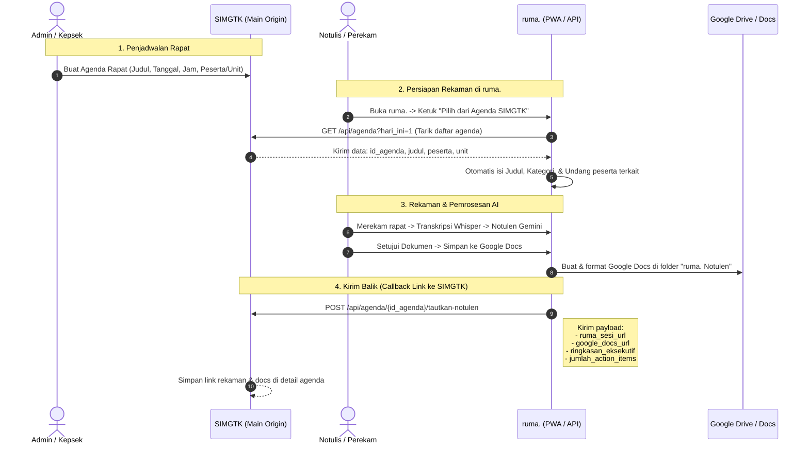

# Konsep Arsitektur: Integrasi Agenda SIMGTK & ruma.

**Tujuan:** menghubungkan jadwal/agenda kegiatan rapat di SIMGTK dengan sistem perekaman, notulensi AI, dan Google Docs di ruma. secara dua arah (*bidirectional*).

---

## 1. Analisis Model Integrasi: Mana yang Lebih Tepat?

Menjawab pertanyaan Anda:
> *"Apakah ruma hanya menyimpan link agenda (nanti api yang mengambil isi agenda), ataukah di SIMGTK yang membuat meeting recording di ruma ketika buat agenda? Dan di agenda SIMGTK nanti ketika terintegrasi ada link recording ruma dan link docs nya?"*

### Perbandingan 2 Alur:

| Aspek | Alur A: Buat Rapat di SIMGTK ➔ Push ke ruma. | Alur B (Disarankan): Buat Agenda di SIMGTK ➔ ruma. Menarik Data (*Pull*) & Mengirim Balik (*Callback*) |
|---|---|---|
| **Pemicu Mulai** | Admin/Kepsek membuat agenda rapat di SIMGTK, SIMGTK memanggil API ruma. `POST /api/sesi/dari-simgtk` untuk membuat draft sesi. | Agenda rapat tetap dibuat di SIMGTK. Saat guru/notulis membuka ruma., ruma. menampilkan tombol **"Pilih dari Agenda SIMGTK"**. |
| **Ketergantungan Sistem** | **Sangat erat (Tightly coupled):** Jika ruma. sedang maintenance, pembuatan agenda di SIMGTK bisa terganggu/error. | **Longgar & Aman (Loosely coupled):** SIMGTK tetap bekerja normal seperti biasa. ruma. hanya membaca agenda saat dibutuhkan. |
| **Hasil Rekaman & Docs** | ruma. harus webhook ke SIMGTK saat selesai. | ruma. mengirim status balik (*Sync-back*) ke SIMGTK: `ruma_sesi_url` dan `google_docs_url`. |

---

## 2. Rancangan Alur Ideal (Alur Hybrid 2 Arah)

---

## 3. Struktur Data yang Disimpan

### Di Database ruma. (`ruma_sesi`)
Tambahkan 2 kolom referensi:
- `simgtk_agenda_id` (varchar/int, nullable): Menyimpan ID agenda dari SIMGTK.
- `simgtk_agenda_payload` (json, nullable): Snapshot judul, deskripsi awal, dan daftar undangan dari SIMGTK agar riwayat tetap utuh meski agenda di SIMGTK diubah.

### Di SIMGTK (Main Origin)
Pada tabel agenda di SIMGTK, tambahkan kolom metadata integrasi:
- `ruma_session_uuid` (char(36), nullable) ➔ Tautan ke pemutar audio & karaoke transkrip di ruma.
- `ruma_session_url` (varchar(500), nullable) ➔ Contoh: `https://ruma.alakhyar.sch.id/sesi/a8eb00cb-...`
- `google_docs_url` (varchar(500), nullable) ➔ Tautan langsung ke Google Docs resmi di Google Drive.
- `notulen_status` (`draft` | `disetujui`, default `null`).

---

## 4. Keuntungan Konsep Ini

1. **Fleksibilitas Perekam:** Notulis bisa langsung merekam tanpa perlu mengisi form manual, cukup memilih agenda yang sudah dijadwalkan di SIMGTK hari itu.
2. **Satu Pintu Informasi di SIMGTK:** Guru atau pimpinan yang membuka SIMGTK nantinya bisa langsung mengklik:
   - 🎧 **"Dengarkan Rekaman (ruma.)"**
   - 📄 **"Buka Notulensi Resmi (Google Docs)"**
3. **Privasi Tetap Terjaga:** ruma. tetap menjadi pemegang hak akses (siapa yang boleh mendengar rekaman suara murid/guru). Di SIMGTK, link hanya ditampilkan untuk guru yang memang berhak hadir di agenda tersebut.
